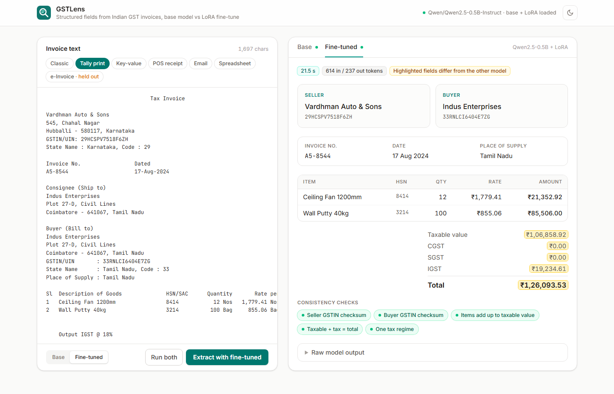
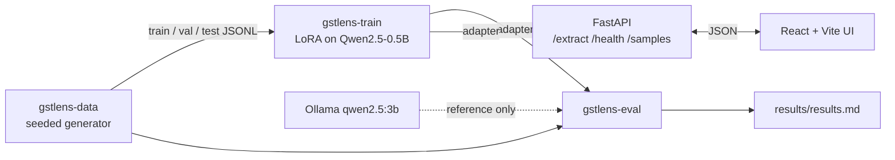

# GSTLens

Fine-tuning a 0.5B open model with LoRA to pull structured fields out of Indian GST invoices, and a measured comparison against prompting the same model.



*A Tally print run through both models. The fine-tuned result is shown; amber fields are where the base model (2-shot) gave a different answer.*

## Why I built this

Invoice extraction is the kind of task people throw a large hosted model at by default. I wanted to know how far a small model running on a 4 GB consumer GPU gets if you fine-tune it on the exact output format, and where it still breaks. GST invoices are a good test: the fields are well defined (GSTINs with a checksum, CGST/SGST vs IGST, HSN codes), but the layouts vary a lot between Tally prints, POS receipts, e-invoice portal printouts and emails.

## What is in the repo

- **Synthetic data generator** (`src/gstlens/data`). Seven invoice layouts, label wording that changes per invoice, Indian number formatting, several date formats, intra-state (CGST+SGST) and inter-state (IGST) invoices, round-off, unregistered buyers, and optional OCR-style noise on labels and spacing. GSTINs have a valid format and check digit. One layout (the e-invoice portal print) is never used for training and only appears in the test set.
- **LoRA fine-tuning** (`src/gstlens/training/train.py`) with transformers + peft on `Qwen/Qwen2.5-0.5B-Instruct`, sized for a GTX 1050 Ti.
- **Evaluation** (`src/gstlens/evaluation`) comparing the base model zero-shot, the base model with two examples in the prompt, the fine-tuned model, and qwen2.5:3b through Ollama as a reference. Reports raw and repaired JSON validity, schema validity, exact match per field, field-level F1, line-item F1, whole-invoice exact match and latency.
- **FastAPI service** (`src/gstlens/api`) with `POST /extract`, `GET /health` and `GET /samples`. The model loads once at startup; one copy of the weights serves both variants by switching the LoRA adapter on and off.
- **React UI** (`web/`) to paste or pick an invoice, run either model, and compare the two results field by field.

## Results

All numbers below come from `uv run gstlens-eval report` on the generated test split (seed 42): 100 invoices in the held-out e-invoice layout and 100 new invoices in the six training layouts. Every system gets the same system prompt with the target schema. Decoding is greedy, one invoice at a time. Full tables, including per-field and per-layout numbers, are in [results/results.md](results/results.md).

**Held-out layout** (GST e-invoice portal print, never seen in training):

| System | Raw valid JSON | Schema valid | Field F1 | Line-item F1 | Whole invoice exact | Latency p50 |
|---|---|---|---|---|---|---|
| Qwen2.5-0.5B, zero-shot | 91% | 3% | 0.568 | 0.235 | 0% | 12.7 s |
| Qwen2.5-0.5B, 2-shot | 81% | 21% | 0.805 | 0.205 | 3% | 15.3 s |
| **Qwen2.5-0.5B + LoRA** | **100%** | **99%** | 0.901 | **0.978** | 44% | **11.1 s** |
| qwen2.5:3b via Ollama (Q4_K_M), 2-shot | 97% | 18% | **0.928** | 0.881 | **50%** | 14.5 s |

**Seen layouts** (classic, Tally print, key-value, POS receipt, email, spreadsheet export):

| System | Raw valid JSON | Schema valid | Field F1 | Line-item F1 | Whole invoice exact | Latency p50 |
|---|---|---|---|---|---|---|
| Qwen2.5-0.5B, zero-shot | 92% | 37% | 0.766 | 0.343 | 0% | 14.0 s |
| Qwen2.5-0.5B, 2-shot | 86% | 10% | 0.806 | 0.534 | 5% | 12.9 s |
| **Qwen2.5-0.5B + LoRA** | **100%** | **100%** | **0.992** | **1.000** | **95%** | **10.8 s** |
| qwen2.5:3b via Ollama (Q4_K_M), 2-shot | 100% | 81% | 0.990 | 0.776 | 66% | 11.4 s |

How to read the columns:

- **Raw valid JSON**: the reply parses as a JSON object exactly as generated. The repair step (strip code fences, cut leading prose, drop trailing commas, close truncated brackets) added at most 5 points for any system, so the gap is not a formatting artefact. "JSON after repair" is in the full table.
- **Schema valid**: the repaired JSON passes the Pydantic `Invoice` model (no extra keys, HSN is digits, dates parse, and so on).
- **Field F1**: micro F1 over the 12 scalar fields. A wrong value counts as both a false positive and a false negative; a null buyer GSTIN counts as correct when the model also returns null. Numbers match within 0.01, strings ignore case and extra spaces, dates must be ISO.
- **Line-item F1**: an item counts only if description, HSN, quantity, rate and amount all match.
- **Whole invoice exact**: every field and every line item correct. Extra keys do not count against this, which is why the 3B model does well here despite a low schema-valid rate.
- **Latency**: wall-clock `generate()` time per invoice on the GTX 1050 Ti for the 0.5B models (fp16, LoRA merged into the weights for the fine-tuned run). Ollama ran the 3B model with a 32k context and put about a third of it on the CPU, so its latency is not a like-for-like comparison.

### What the fine-tune fixed

- **Output format.** The base model, even with two examples, invents keys (`net_amount`, `round_off`, `cess`, `tax_rate` inside items), puts "Taxable Amount", "CGST" and "Total Payable" rows into `line_items`, or keeps going until the token limit. After LoRA training every reply parsed, and 199 of 200 passed the schema.
- **Normalisation.** Zero-shot, the base model copied dates as printed (`16-Jun-2025`), so `invoice_date` was right 3% of the time on the held-out layout, and it returned `null` for almost every buyer GSTIN. The fine-tuned model got dates and place of supply right on all 200 test invoices.
- **Line items.** Line-item F1 went from 0.2-0.5 to 0.98-1.00. The base model often split "Wall Putty 40kg" into a description and a quantity of 40, or swapped rate and amount.
- **Speed and prompt size.** The fine-tuned model needs no examples in the prompt (644 prompt tokens on average against 1,782 for 2-shot) and writes compact JSON, so it was the fastest of the four.

### Where it still fails

On the held-out layout the fine-tuned model gets 44% of invoices fully right. The misses are concentrated in a few fields (from `gstlens-eval failures finetuned`): `taxable_value` 42 invoices, seller/buyer fields 15-16 each, `igst` 8, line items 5.

1. **Taxable value read from the wrong column.** The e-invoice print has a per-line `Total(Rs)` column (amount plus tax) and puts the totals in a header row with the values on the line below. In 28 of the 42 `taxable_value` misses the model copied a line's `Total(Rs)` value instead. Example `test-heldout-00011`:

   ```
   SlNo Item Description          HSN Code  Quantity Unit  Unit Price(Rs)  Taxable Amount(Rs)  Tax Rate  Total(Rs)
   1    Notebook 200 Pages        4820            12 NOS            59.92              719.04       12%     805.32
   ...
   4. Tax Summary
       Tax'ble Amt       CGST Amt       SGST Amt       IGST Amt       CESS Amt      Round off Total Inv. Amt
          8,343.84         500.63         500.63           0.00           0.00           0.00       9,345.10
   ```

   The correct `taxable_value` is 8343.84; the model returned 805.32. Every other field in this invoice, including the three line items, was right. The 3B model handles this layout better (87% on `taxable_value` against 58%).

2. **Seller and buyer swapped when the two columns run together.** The e-invoice puts supplier and recipient side by side. When a long supplier name fills its column there is no gap left (`Legal Name : Venkateshwara Tech Solutions Pvt LtdLegal Name : Ashoka Steels Traders`), and the model swaps the parties and their GSTINs. 14 of the 15 swaps on the held-out set have this glued line. That is partly a quirk of my renderer, but it is also what bad OCR of a two-column page looks like.

3. **Adding up tax across rates.** On the seen layouts the remaining errors are mostly Tally prints with two GST rates, where the CGST and SGST totals are not printed and have to be summed from `Output CGST @ 6%` and `Output CGST @ 9%` lines. Two of the three such invoices in the test set came back with only one rate's amount (`test-seen-00085`: CGST 29,989.51 instead of 99,091.78). Copying text is reliable at 0.5B; arithmetic is not.

### Training setup

| | |
|---|---|
| Base model | `Qwen/Qwen2.5-0.5B-Instruct` (494M parameters) |
| GPU | GTX 1050 Ti, 4 GB, Pascal (sm_61), Windows 11, CUDA 12.6 driver, PyTorch 2.6.0+cu126 |
| Data | 2,375 training invoices (25 of 2,400 dropped for being over 1,024 tokens), 48 validation invoices for eval loss |
| LoRA | r = 16, alpha = 32, dropout 0.05 on q, k, v, o, gate, up and down projections; 8.8M trainable parameters (1.75%) |
| Precision | frozen base weights in fp16, LoRA weights in fp32, fp16 autocast with loss scaling (no bf16 on Pascal) |
| Memory | gradient checkpointing, batch size 1, gradient accumulation 8, max length 1,024 tokens; peak 1.83 GB allocated |
| Optimiser | AdamW, learning rate 2e-4, cosine schedule, 3% warmup, 1 epoch = 297 optimiser steps |
| Time | 75 minutes (4,503 s, about 15 s per step) |
| Loss | average train loss 0.0059, final eval loss 0.0014 |

Two details made this fit on 4 GB. First, the loss is only computed on the JSON answer, and the trainer asks the model for logits only at those positions (`logits_to_keep` with an index tensor). With a 152k-token vocabulary, full-sequence logits would be the largest tensor in the step. Second, consumer Pascal cards run fp16 matrix multiplies with fp32 accumulation at about fp32 speed (I measured 1.74 vs 1.85 TFLOPS on a 2048x2048 matmul), so fp16 weights halve memory without slowing things down. I used the plain `transformers` `Trainer` with a small `compute_loss` override instead of TRL's `SFTTrainer`, because the custom loss was the part that mattered.

### About the data

The test set is synthetic, so these numbers say how well each approach learns a known family of layouts and how it copes with one new layout. They do not say how it would do on scanned invoices from real businesses. About 25% of invoices get OCR-style noise on labels and spacing (never on the values), 41% of training invoices are inter-state (IGST), 15% have an unregistered buyer, and each invoice has 1 to 4 line items.

## Architecture



The extraction path is the same everywhere: build chat messages (system prompt with the schema, optional few-shot turns, invoice text), greedy decode, parse JSON with a small repair step, validate with Pydantic, then run consistency checks (GSTIN check digits, items add up to taxable value, taxable + tax equals total within round-off, only one tax regime).

## Tech stack

Python 3.12, PyTorch 2.6 (CUDA 12.6 wheels), transformers 5, peft, FastAPI, Pydantic v2, pydantic-settings, Faker, pytest, ruff, uv. Frontend: React 19, TypeScript, Vite, Tailwind CSS 4.

## How to run

Everything below works without Docker. You need [uv](https://docs.astral.sh/uv/) and Node 20+.

```bash
uv python install 3.12
uv sync --all-extras          # installs torch 2.6.0+cu126 from the PyTorch index
uv run gstlens-data           # writes data/generated/{train,val,test}.jsonl with seed 42
```

### Train

```bash
# a 6-step smoke run first, to check memory and the pipeline
uv run gstlens-train --limit 48 --max-steps 6 --grad-accum 4 --eval-steps 6 --eval-examples 8 --output-dir artifacts/smoke
# the real run (about 75 minutes on a GTX 1050 Ti)
uv run gstlens-train
```

The adapter is written to `artifacts/qwen05b-lora/adapter` (git-ignored, about 35 MB).

### Evaluate

```bash
uv run gstlens-eval run --systems base-zero base-few finetuned
uv run gstlens-eval run --systems ollama-few        # optional, needs `ollama pull qwen2.5:3b`
uv run gstlens-eval report                          # writes results/results.md and results/metrics.json
uv run gstlens-eval failures finetuned --split test_heldout
```

Predictions are appended to `artifacts/eval/<system>.jsonl`, so an interrupted run picks up where it stopped.

### API and UI

```bash
uv run uvicorn gstlens.api.main:app --port 8000
cd web && npm install && npm run dev                # http://localhost:5173, proxies /api to :8000
```

```bash
curl -s localhost:8000/extract -H 'content-type: application/json' \
  -d '{"text": "<invoice text>", "model": "finetuned"}'
```

Errors come back as `{"error": {"code", "message", "details", "raw_output"}}`: `invalid_request` (422) for bad input, `invalid_model_output` (422) when the model reply does not fit the schema (with the raw output and the failing fields), `model_unavailable` (400) when the adapter is not loaded, `text_too_long` (413).

The API keeps the LoRA adapter separate from the base weights so that one copy of the model on the GPU serves both variants. The price is speed: on the 1050 Ti, fine-tuned requests through the API took 17-21 s on the sample invoices, against an 11 s median in the eval, where the adapter is merged into the weights. If you only need the fine-tuned model, merging it is the better trade.

`?sample=tally&run=both&theme=light` on the UI URL loads a sample and runs both models straight away, which is how the screenshot was taken.

### Tests and lint

```bash
uv run pytest
uv run ruff check src tests && uv run ruff format --check src tests
cd web && npm run build && npm run lint
```

The API tests use a fake generator, so they do not need a GPU or model download.

### Docker

`docker compose up --build` builds the API (CUDA torch wheels, needs the NVIDIA container toolkit) and the UI behind nginx on port 5173. Mount a trained adapter into `./artifacts`. I have not been able to run the Docker setup on this machine.

## Configuration

All settings are environment variables with the `GSTLENS_` prefix (see `.env.example`).

| Variable | Default | Meaning |
|---|---|---|
| `GSTLENS_BASE_MODEL` | `Qwen/Qwen2.5-0.5B-Instruct` | Hugging Face model id |
| `GSTLENS_ADAPTER_PATH` | `artifacts/qwen05b-lora/adapter` | LoRA adapter; if missing the API serves the base model only |
| `GSTLENS_DEVICE` | `auto` | `cuda`, `cpu` or `auto` |
| `GSTLENS_DTYPE` | `float16` | weights dtype on GPU (CPU always uses float32) |
| `GSTLENS_MAX_NEW_TOKENS` | `640` | generation cap |
| `GSTLENS_BACKEND` | `hf` | `hf` for local transformers, `openai` for any OpenAI-compatible server |
| `GSTLENS_BASE_PROMPT` | `few_shot` | prompt for the base variant: `few_shot` or `zero_shot` |
| `GSTLENS_OPENAI_BASE_URL` | `http://localhost:11434/v1` | used by the `openai` backend and the Ollama eval |
| `GSTLENS_OPENAI_MODEL` | `qwen2.5:3b` | model name on that server |
| `GSTLENS_MAX_INPUT_CHARS` | `12000` | request size limit |

## What I'd do next

- Add a second held-out layout and some real, anonymised invoices to see whether the e-invoice result holds up.
- Generate training layouts with header-row tables and side-by-side party blocks, the two patterns the model failed on, and check that it learns the pattern rather than the template.
- Have the model return line items and tax rates only, and compute taxable value, CGST/SGST/IGST and total in code. The consistency checks already flag most arithmetic mistakes; computing the totals would remove them.
- Constrained decoding against the JSON schema (a grammar-based logits processor), so the base model comparison is about content rather than format.
- Try Qwen2.5-1.5B with the same recipe. The 4 GB card is the limit; it would need 4-bit base weights.
